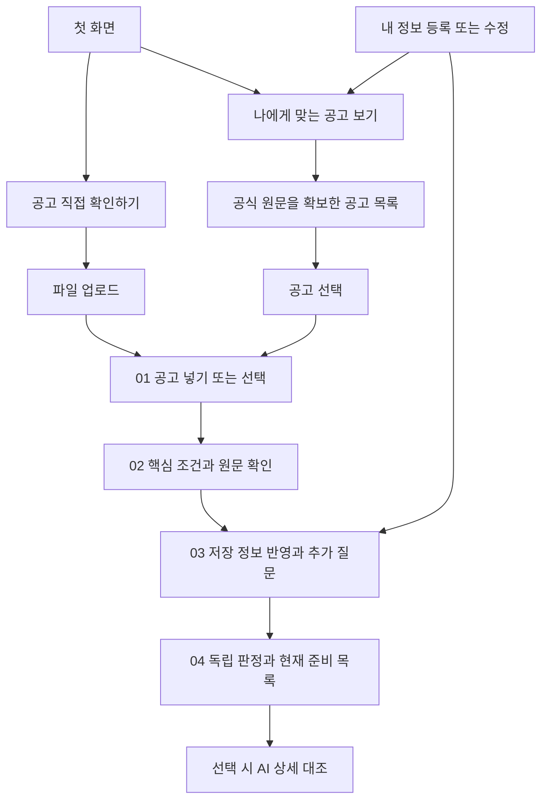
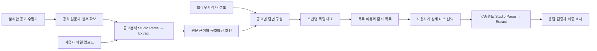

# 공고다음 프로필 재사용과 공고 탐색 기능 명세 및 개발 계획

5G 팀의 공고다음을 공통 프로필 재사용과 공고 탐색으로 확장한다. 사용자는 직접 공고를 올리거나 검증된 공고 목록에서 선택하고, 같은 조건별 독립 판정표와 준비 목록으로 이어진다. 핵심 가치는 반복 입력을 줄이면서 추천 이유와 추가 확인 사항을 원문 근거로 설명하는 것이다.

2026년 10월 14일 갱신: 기존 공식 게시판 수집기를 웹앱에 연결했다. '공고 찾기'에서 최신 공고를 불러오고, 본문 또는 첨부 문서를 선택해 실제 Upstage 분석을 실행하면 공용 목록에 반영한다. 수집 범위는 세종대학교 공식 장학 게시판 첫 페이지이며, 정기 수집과 전국 통합 검색은 포함하지 않는다. 아래의 초기 설계·10월 13일 검증 기록은 이 변경과 구분한다.

새 공개 목록은 서버의 runtime/public_catalog.sqlite3에 원문·해시·분석 버전·실행 ID와 함께 저장한다. 개인 정보와 API 키는 저장하지 않는다. 완료 결과 중복 호출을 막고, 실패 결과는 게시하지 않으며, 실행 ID가 있는 중단 요청은 같은 작업을 다시 조회한다. 인스턴스 재배포·초기화 시 동적 목록이 사라질 수 있으므로 영구 DB 또는 자동 게시로 표현하지 않는다. 검토 중인 공고의 기존 브라우저 저장은 유지한다.

## 개발 범위

| 상태 | 구현 범위 | 확인 범위 |
| --- | --- | --- |
| 구현 | 공통 프로필 등록·수정·삭제, 공고별 답변·체크 분리 | 기존 v1 저장 이전, 공고 A→B→A, 명시적 모름 우선 |
| 구현 | 공식 원문 5개의 목록과 조건 대조 | 종류·접수 상태·키워드 필터, 근거와 마감 표시 |
| 구현 | 공식 장학 게시판 1곳의 수집 → 원문 선택 → Upstage 분석 → 목록 반영 | 버튼으로 실행. 본문 표·각주·이미지 재구성 및 첨부 원본 선택. 미분석 첨부 범위 표시. 정기 실행 제외 |
| 미검증 | 모바일 390px·독립 사용자 기기 | 반응형 코드 및 세션 분리 테스트는 있으나 기기 검증 미실시 |
| 제외 | 계정·기기 동기화, 자동 접수, 전국 검색 | 현재 제출 범위 아님 |

전국 장학금 전체 검색, 당첨 확률 예측, 자동 지원·접수, 증빙 진위 판정, 이메일·Slack 자동 전송은 이번 범위에서 제외한다. 검증 문서가 마감된 공고라면 과거 사례로 표시하며 현재 접수 중 목록에 넣지 않는다.

## 사용자 흐름

첫 화면에는 **공고 직접 확인하기**와 **나에게 맞는 공고 보기**를 둔다. 내 정보 등록은 선택 사항이며, 공고 하나만 확인하려는 사용자에게 회원가입이나 긴 프로필 작성을 요구하지 않는다. 인스타 색상 테마와 기존 네 단계 화면은 유지한다.

공고 목록은 네 단계 앞의 진입 화면이다. 프로필은 상시 접근 가능한 별도 화면으로 둔다. 공고를 선택하면 기존 검토 흐름으로 들어가고, 목록으로 돌아가도 해당 공고의 답변을 보존한다. 모바일에서는 목록 카드·판정표·질문을 한 열로 배치한다.

## 화면과 기능 명세

| 기능 | 사용자가 하는 일 | 시스템 동작과 완료 기준 |
| --- | --- | --- |
| 내 정보 | 기본 정보를 선택적으로 입력한다 | 미입력·모름과 값·기준 시점·만점 기준을 저장한다 |
| 프로필 적용 | 저장된 정보로 공고를 검토한다 | 적용한 항목을 표시하고 해당 공고에서 수정할 수 있게 한다 |
| 공고별 수정 | 이번 공고에 다른 답변을 입력한다 | 공통 프로필을 자동 덮어쓰지 않는다. 공통 정보 수정은 별도 동작으로 처리한다 |
| 필요한 질문 | 추가 질문에 답하거나 건너뛴다 | 공고의 어떤 조건에 연결됐는지와 왜 필요한지 표시한다 |
| 공고 목록 | 종류·접수 상태·관심 분야로 목록을 좁힌다 | 검색 대상 사이트·목록 갱신 시각·원문 확인 상태를 표시한다 |
| 추천 이유 | 공고 카드에서 일치·미확인을 확인한다 | 확인된 불일치를 숨기지 않으며 지원 가능 확률을 만들지 않는다 |
| 원문 확인 | 공식 공고·첨부와 조건 근거를 연다 | 출처, 페이지 또는 구간, 마지막 확인일을 제공한다 |
| 준비 목록 | 적용 대상과 준비 상태를 각각 표시한다 | 현재 단계·이후 단계·시점 미확정을 분리한다 |
| 정보 변경 | 프로필이나 공고별 답변을 수정한다 | 영향을 받는 조건을 다시 대조하고 이전 AI 결과를 최신으로 표시하지 않는다 |
| 저장 관리 | 프로필 또는 공고 기록을 지운다 | 삭제 범위를 구분한다. 프로필 삭제가 공고 원문까지 지우지 않는다 |
| 결과 저장 | 현재 검토 결과를 내려받는다 | 적용한 답변·기준 시점·원문 버전과 결과를 함께 기록한다 |

서류 준비 완료·접수 완료는 사용자의 표시임을 유지한다. 성적증명서의 진위, 최신 발급 여부, 실제 접수 완료를 자동 확인했다고 표현하지 않는다.

## 정보 저장 범위

| 범위 | 주요 항목 | 적용 규칙 |
| --- | --- | --- |
| 공통 프로필 | 학교·캠퍼스, 대학 유형, 전공, 학적, 관심 분야, 선택적 활동 가능 지역 | 공고 간 재사용하되 사용자가 확인할 수 있어야 한다 |
| 시점이 필요한 프로필 | 학년·잔여학기, 성적·만점 기준·해당 학기, 학자금 지원구간·대상 학기 | 공고 기준일과 다르거나 유효성을 확인하지 못하면 재확인 질문으로 남긴다 |
| 공고별 답변 | 희망 기관, 특정 일정 참석 여부, 공고별 자격 질문, 지원 단계 | 공고 식별자와 함께 저장하며 다른 공고로 복사하지 않는다 |
| 공고별 서류 | 서류 적용 대상, 준비 상태, 제출 상태 | 동일한 이름의 서류라도 다른 공고에서는 새로 확인한다 |

최초 프로필 화면은 학교·캠퍼스, 학적, 전공, 관심 분야를 중심으로 짧게 구성한다. 추가 정보는 해당 공고에서 필요할 때 묻는다. 학교 소재지와 거주지, 대학 유형과 학적은 서로 다른 값이다. 학교명만으로 소재지나 대학 유형을 추측해 확정하지 않는다.

사회적 배려 범주의 상세 정보와 학자금 지원구간은 선택 입력이며, 수집 목적을 공고 조건 대조로 한정한다. 한 공고에서 인정된 우대 범주가 다른 공고에도 인정된다고 간주하지 않는다. 주민등록번호·계좌·증빙 원본의 사전 등록은 요구하지 않는다.

초기 버전은 같은 브라우저에 저장한다. 기기 간 동기화나 계정별 보관으로 표현하지 않는다. API 키는 브라우저에 저장하지 않으며, 개인 프로필과 답변을 공개 공고 목록·공용 캐시에 넣지 않는다.

## 조건 대조와 추천 규칙

판정 단위는 공고 전체가 아니라 개별 조건이다. 한 조건의 미입력은 다른 조건의 불일치를 지우지 않는다. 조건이 모두 추출됐는지 검증하지 못한 공고에서는 일부 일치 항목만으로 전체 자격을 확정하지 않는다.

| 개별 조건 상태 | 판정 기준 | 화면 예시 |
| --- | --- | --- |
| 일치 | 근거가 확인된 조건과 해당 시점의 답변이 일치한다 | 잔여학기 2학기 이상 / 내 답변 3학기 |
| 불일치 | 근거가 확인된 조건과 답변이 명백히 어긋난다 | 잔여학기 2학기 이상 / 내 답변 1학기 |
| 확인 필요 | 답변·원문·기준일·조건 연결 중 하나가 부족하다 | 대학 소재지역 미입력 |
| 해당 없음 | 조건의 적용 대상을 확인했고 사용자가 대상이 아니다 | 특정 기관 선택자 우대 / 다른 기관 선택 |
| 이후 단계 | 현재 준비 시점에 적용되지 않는 서류나 질문이다 | 선발 후 협약 시 제출 |
| 시점 확인 필요 | 서류가 언제 필요한지 근거가 불명확하다 | 현재 누락으로 계산하지 않고 원문 확인 안내 |

목록에는 **확인된 불일치 없음**, **확인된 불일치 있음**, **원문 검토 필요**를 구분하고 일치·미확인 항목 수를 함께 표시한다. ‘확인된 불일치 없음’은 ‘지원 자격 충족’과 다르다. 우대 불일치나 선택서류 미준비는 필수 지원 조건 불일치로 확대하지 않는다.

현재 목록은 새로 분석한 인터넷 공고를 먼저 표시하고, 기본 목록은 마감일 내림차순으로 정렬한다. 종류·접수 상태·관심 키워드로 필터링한다. 저장한 프로필은 조건 대조에 사용한다. 관심 분야에 따른 자동 개인화 순위는 구현하지 않았다. 미확인 조건이 적다는 이유로 높은 점수를 주지 않으며, 불일치 없음은 전체 자격 충족이 아니다.

성적은 만점 기준과 대상 학기가 일치할 때만 대조하며 임의 환산하지 않는다. 복합 조건은 AND·OR·예외 관계를 보존할 수 있을 때만 자동 판정한다. 자유서술 답변이나 연결이 모호한 조건은 답변이 있다는 이유만으로 일치 처리하지 않는다.

## 처리 구조와 재사용 범위

현재 공고분석은 Studio 설정 13의 Parse → Classify → 유형별 Extract → Instruct를 사용한다. 맞춤검토는 설정 2의 Parse → Extract다. 실제 내보내기를 보관했다. 프로필 저장·공식 게시판 수집·중복 제거·정렬·수치 검증·목록 반영은 앱 코드가 맡는다. 기본 카탈로그 5건의 과거 분석 버전은 각 기록에 보존한다.

기존 39개 추출 필드를 유지하고 profile_conditions_json 문자열 필드를 추가했다. 대학 유형·소재지·학기·성적 등 조건을 프로필 키, 원문 인용, 페이지, 기준 시점과 연결한다. 실제 Studio 설정 7로 공개 문서 5개를 새로 실행했다. 미지원·복합 조건은 확인 필요로 남긴다.

앱 내부 조건은 조건 ID, 종류, 프로필 키, 비교 연산, 값·단위, 시점·범위, 인용·페이지를 포함한다. Studio에서는 JSON 배열을 문자열 한 필드로 추출하고 앱이 허용 키와 구조를 검증한다. 인용이 원문에 없거나 복합 논리·예외가 있으면 단순 수치 판정을 하지 않는다.

기존 contest-agent의 공개 HTTP 수집 코드를 public_network.py로 분리해 재사용했다. 자동 작업을 생성하는 discover()는 호출하지 않고, collect_notices.py가 세종대학교 장학 게시판의 후보·URL 정리·중복 제거·본문 및 첨부 해시 기록을 담당한다. 운영 DB·개인 프로필·Slack·개발·출품 실행기는 연결하지 않았다.

배포 앱은 개발자 PC의 파일 경로를 직접 참조하지 않는다. 기본 공개 공고 목록 파일과 서버의 동적 목록을 함께 읽는다. 사용자가 가져오기·분석 버튼을 누르면 수집과 Studio 호출을 진행하고 완료 결과를 공용 목록에 반영한다. 정기 실행과 기존 출품 작업은 연결하지 않는다.

## 공고 목록과 데이터 계약

| 데이터 | 필수 내용 | 보관 범위 |
| --- | --- | --- |
| 프로필 | 프로필 버전, 값, 미입력·모름·입력 상태, 확인일, 해당 학기 또는 기준일 | 개인 브라우저 |
| 공고 | 공고 ID, 제목, 기관, 종류, 발견 주소, 공식 원문·첨부 주소, 접수 기간, 확인 시각 | 공개 정보 공용 목록 |
| 문서 버전 | 원문 해시, 첨부 해시, Studio 설정 버전, 추출 스키마 버전, 분석 상태 | 공개 원문만 공용 재사용 가능 |
| 개별 조건 | 조건 ID·종류·논리 관계, 프로필 키, 기준값·단위·시점, 인용·페이지 | 해당 공고 버전 |
| 공고별 상태 | 공고 ID, 문서 버전, 답변 덮어쓰기, 체크 상태, 지원 단계 | 개인 브라우저 |
| 검토 결과 | 공고·프로필·답변·규칙·Studio 버전과 결과 | 현재 개인 세션, 사용자가 내려받기 가능 |

조건별 대조에 사용할 답변은 **공고별 명시 답변 → 기준 시점이 맞는 공통 프로필 → 미입력** 순으로 구성한다. 예외적으로 공고별 답변에서 ‘모름’을 선택했다면 과거 프로필 값으로 되돌려 채우지 않는다. 답변 출처를 저장 정보 또는 이번 공고 답변으로 표시한다.

공고분석 재사용 키는 원문·첨부 해시와 Studio·스키마 버전을 포함한다. 개인 검토 결과는 적용된 프로필 값·공고별 답변·지원 단계·규칙 버전도 포함한다. 프로필을 수정하면 영향을 받는 결과를 낡은 결과로 표시하고, 사용자가 AI 상세 대조를 누를 때 다시 호출한다. 키·답변을 로그나 공개 캐시 식별자에 평문으로 넣지 않는다.

수집기는 HTML과 첨부 바이트의 SHA-256 및 확인 시각을 기록한다. 재구성 PDF에는 확인 시각과 조회수 등을 넣지 않아 같은 본문은 같은 해시로 비교할 수 있다. 사용자가 분석을 누르면 원문 해시·Studio 버전을 확인하고, 완료 결과를 재사용하거나 실제 분석 후 목록에 반영한다. 첨부와 본문은 별도 분석 범위로 표시하며, 내용 변경 시 기존 개인 체크리스트를 자동 이전하지 않는다.

원문 확보 실패, 분석 실패, 접수 상태 미확인, 변경 후 재검토 중을 빈 추천 목록과 구분한다. 원문 없이 제목만 수집한 항목은 탐색 후보이며 맞춤 검토를 마친 공고처럼 표시하지 않는다.

## 상태 이전과 실패 처리

현재 브라우저 저장은 버전 2다. 공통 프로필과 원문 해시별 공고 상태를 나누며 v1 기록은 별도 백업 후 이전한다. 기존 자유서술 답변은 프로필로 승격하지 않는다. 여러 탭은 저장 버전이 충돌하면 덮어쓰지 않고 백업 다운로드·새로고침을 안내한다.

1. 기존 기록을 읽고 보존한 뒤 현재 공고의 기록으로 옮긴다.

2. 기존 자유서술 답변을 공통 프로필로 자동 승격하지 않는다.

3. 사용자가 확인한 항목만 공통 프로필에 저장한다.

4. 새 저장이 성공한 뒤 새 구조를 사용한다. 실패하면 기존 기록을 유지하고 다운로드 방법을 제공한다.

5. 공고를 전환해도 공통 프로필은 유지하고, 해당 공고의 답변·서류만 불러온다.

프로필이 바뀌면 기존 공고별 답변과 다른 항목을 표시하고 어느 답변을 사용할지 사용자에게 보여준다. 기존 공고별 답변을 몰래 덮어쓰지 않는다. 서류 항목을 새 문서 버전에 연결할 근거가 부족하면 완료 체크를 자동 이전하지 않는다.

API 호출은 공고 분석·상세 대조 버튼 또는 승인된 공용 공고 분석 작업에서만 수행한다. 프로필 수정·단계 이동·목록 필터 변경마다 유료 AI를 호출하지 않는다. 실패한 호출을 자동 무한 재시도하지 않고, 완료 여부가 불확실하면 중복 호출 전에 기존 실행 상태를 확인한다.

현재 사용자가 선택한 공개 테스트 운영 설정과 호출 정책은 그대로 둔다. 새 기능에서는 개인 답변이 다른 사람의 결과나 공개 공고 목록에 섞이지 않는지 별도로 검증한다.

## 검증 계획과 출시 기준

공식 공고 5개(PDF 1·포스터 2·HWP 2) × 가상 프로필 3개 = 선택 조건 15개 검사에서 15개 통과, 0개 실패했다. 새 문서는 세종대 게시판의 K-원전 장학금 HWP다. 15건은 전체 추출 정확도나 전체 자격 정답률을 의미하지 않는다. 개발 폴더와 공개 저장소에서 같은 자동 테스트 111개를 각각 통과했다.

| 사례 | 기대 결과 |
| --- | --- |
| 잔여학기 불일치와 지역 미입력 동시 존재 | 불일치 유지, 지역만 확인 필요 |
| 필수 조건 답변은 있고 우대만 미입력 | 필수 판정과 우대 확인 필요 분리 |
| 우대 대상이지만 증빙 미준비 | 대상 여부와 서류 준비를 분리 |
| 특정 기관 우대만 비적용 | 다른 우대 조건을 그대로 검토 |
| 선택서류 미준비 | 필수 누락이나 자격 미달로 표시하지 않음 |
| 이후 단계 서류 포함 | 현재 준비 목록에서 제외 |
| 프로필 기준 학기와 공고 기준일 다름 | 재확인 요청, 무조건 일치하지 않음 |
| 성적 만점 기준·대상 학기 불명확 | 임의 환산 없이 확인 필요 |
| 공고 전환 | 공통 정보만 재사용, 체크 상태 섞임 없음 |
| 프로필과 공고별 답변 충돌 | 적용 답변과 출처 표시, 이전 AI 결과 무효화 |
| 원문·첨부 수정 | 새 버전 표시, 영향을 받는 조건 재검토 |
| 중복 공고·마감·수집 실패 | 중복 노출 방지, 상태를 정확히 표시 |
| 새로고침·여러 탭·모바일 | 입력 복원, 덮어쓰기 충돌 처리, 390px 가로 넘침 없음 |
| 다른 사용자 세션 | 개인 프로필·답변·결과 공유 없음 |

검증 기록은 문서·페이지 → 원문 조건 → 가상 답변 → 기대 결과 → 실제 결과 → 통과·실패·미검증 → 사용자 영향 형식이다. 14개 경계 범주 중 12개 통과, 2개 부분 검증이다. 새로고침·탭 충돌은 확인했지만 모바일 390px는 도구의 크기 변경이 적용되지 않아 미검증이다. 독립 세션 저장 테스트는 통과했지만 별도 사용자 기기 검증은 미실시다.

출시 기준은 표본 내 확인된 불일치 소실 0건, 공고 간 체크 상태 혼입 0건, 이후 서류의 현재 누락 오안내 0건, 미입력의 해당 없음 오표시 0건이다. 프로필 재사용으로 반복 질문 수가 기존보다 줄어야 하며, 필요한 추가 질문은 생략하지 않아야 한다. 각 수치는 검사한 사례 수와 함께 보고한다.

팀원에게 공고 2개씩 연속 검토하게 해 반복 입력 수, 원문 재확인 횟수, 준비할 서류를 정확히 설명할 수 있는지 측정한다. 실제 참여한 인원과 시간을 기록하며 시간 절감률이나 전체 정확도를 미리 주장하지 않는다.

## 반영 범위와 남은 작업

구현과 배포를 마쳤으며 남은 검증을 분리한다. 실제 신규 공고 분석 5회와 배포 후 맞춤검토 1회가 성공했다. 기존 HWPX·우대 조건 검사는 이전 실제 추출 기록을 재생한 회귀 검사이며 신규 API 실행으로 계산하지 않는다.

| 영역 | 현재 상태 | 다음 확인 |
| --- | --- | --- |
| 프로필·공고 저장 | 구현 및 브라우저 복원 확인 | 독립 사용자 기기 점검 |
| 목록·조건 연결 | 공개 공고 5개 및 15조합 검사 | 실제 사용자 반복 입력 수 측정 |
| Studio·배포 | 설정 7·2 및 실제 맞춤검토 성공 | 복합 조건 원문 대조 확대 |
| 모바일 | 반응형 유지, 390px 미검증 | 휴대전화에서 폼·체크·새로고침 확인 |
| 수집 운영 | 웹앱 버튼으로 수집·분석·공용 목록 반영 | 출처 확대·영구 저장·정기 실행은 별도 범위 |

수동으로 검증·배포한 기본 5건과 사용자가 가져와 AI 분석한 공고를 구분한다. AI 분석 완료를 운영자가 전체 사실관계를 검증한 것으로 표시하지 않는다. 정기 수집, 전국 장학금 검색, 계정 동기화, 동적 목록의 영구 저장은 완료 기능으로 표시하지 않는다.

제출용 워크플로우는 실제 공고분석 설정 13과 맞춤검토 설정 2로 맞춘다. 기획서에는 현재 화면·검증 분모·미검증 범위를 반영하며 LMS 제출은 팀이 직접 진행한다.

## 다음 개발의 완료 단위

2026-10-14 추가 구현: `내 정보 → 저장하고 최신 공고 찾기` 또는 `공고 찾기 → 최신 공고 찾기`로 공식 게시판 수집, 본문·첨부의 Studio 분석, 공고별 묶음과 개인별 우선순위까지 이어진다. 기본 최신 3개이며 검색 범위에서 변경할 수 있다. 검색은 세종대학교 공식 장학 게시판 첫 페이지에 한정한다.

마감된 공고는 뒤에 두고, 확인된 자격 불일치가 없는 공고 안에서 지원 자격 일부 일치, 우대 일부 일치, 관심 키워드를 순서대로 반영한다. 미입력 수로 순위를 낮추거나 지원 가능 확률을 만들지 않는다. 우대 조건 불일치와 서류 준비 상태는 자격 탈락으로 바꾸지 않는다. 프로필 변경에 따른 정렬은 추가 AI 호출 없이 수행한다.

본문과 지원되는 첨부를 각각 분석해 한 공고에 묶는다. 출처별 최신 문서 목록과 원문 해시를 저장해 변경 전 결과를 최신 판단에 섞지 않는다. 원문 다운로드·특정 첨부 분석 실패는 표시하고 나머지는 계속 진행한다. 문서별 근거와 페이지를 유지하고, 마감일이 서로 다르면 접수 상태 확인 필요로 남긴다. 정정 문서의 우선관계를 자동으로 해석하는 기능은 포함하지 않는다.

내 정보 등록 → 공고 A 검토 → 공고 B 검토 → 공고 A 복귀를 구현했다. 같은 기본 정보는 재사용하고 공고별 답변과 서류 체크를 따로 복원한다. 직접 답변은 공통 프로필보다 우선하며 확인된 불일치는 다른 미입력으로 사라지지 않는다.

다음 확인은 실제 휴대전화와 별도 사용자 브라우저에서 같은 흐름을 반복하는 것이다. 소수의 검증된 목록에서 추천 이유를 이해할 수 있는지 먼저 관찰하고, 질문 연결과 근거 표시를 개선한 후 수집원을 늘린다.

## 기준 자료

- [현재 공고다음 코드](https://github.com/taewankim22/gonggo-next-5g): 공통 프로필, 원문 해시별 공고 상태, 브라우저 저장 버전 2, 기본·동적 공개 카탈로그, Studio 설정 13·2.

- [현재 배포 서비스](https://gonggo-next-5g-gjkapf7kye4lzappppjuy9s6.streamlit.app/).

- 기존 contest-agent의 intake.py·network.py를 확인했다. 자동 작업 생성 경로는 분리하고 공개 HTTP 수집 부분만 재사용했다. 장학 수집은 세종대학교 공식 게시판 1곳에서 후보 10·상세 3·HWP 첨부 1건을 실제 확인했다.

- 첨부 미니 미션 2 안내: 2026년 10월 14일 중간 제출, 기획서·실제 Studio 설정·샘플 문서 제출.

- [공식 Playbook](https://ku-sejong-hackathon-playbook.vercel.app/): 해커톤 실습·제출 참고 자료. 본 명세의 우선순위와 작업량은 공식 심사 배점이 아니다.
